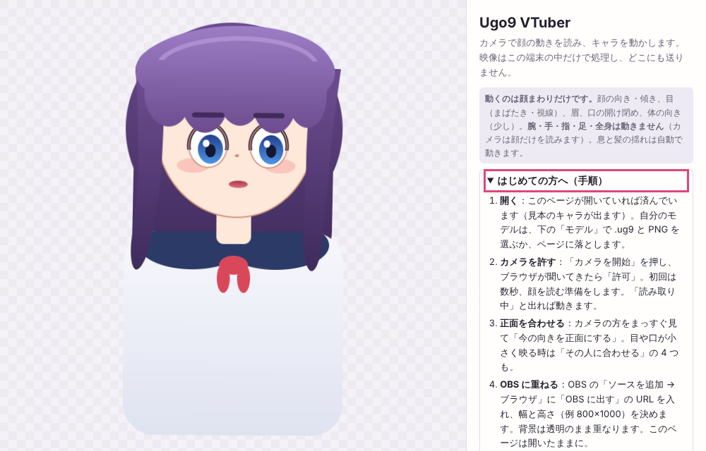
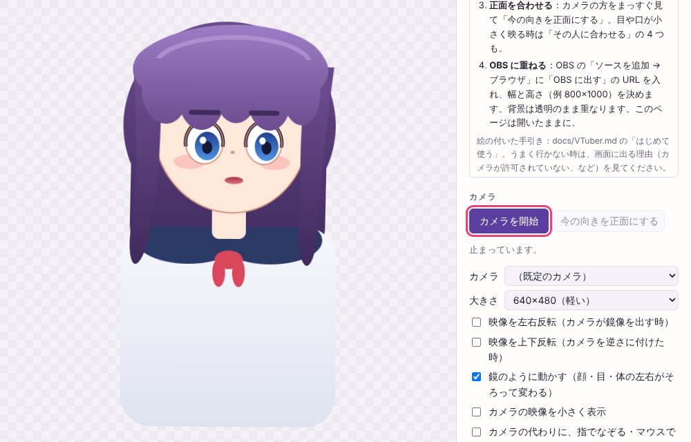
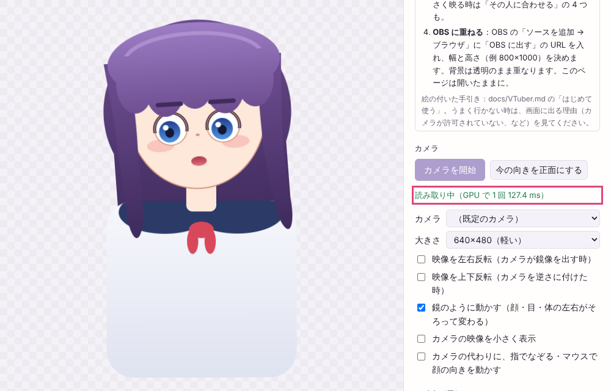
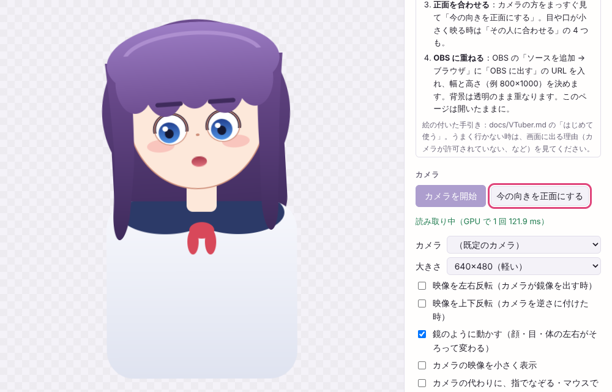
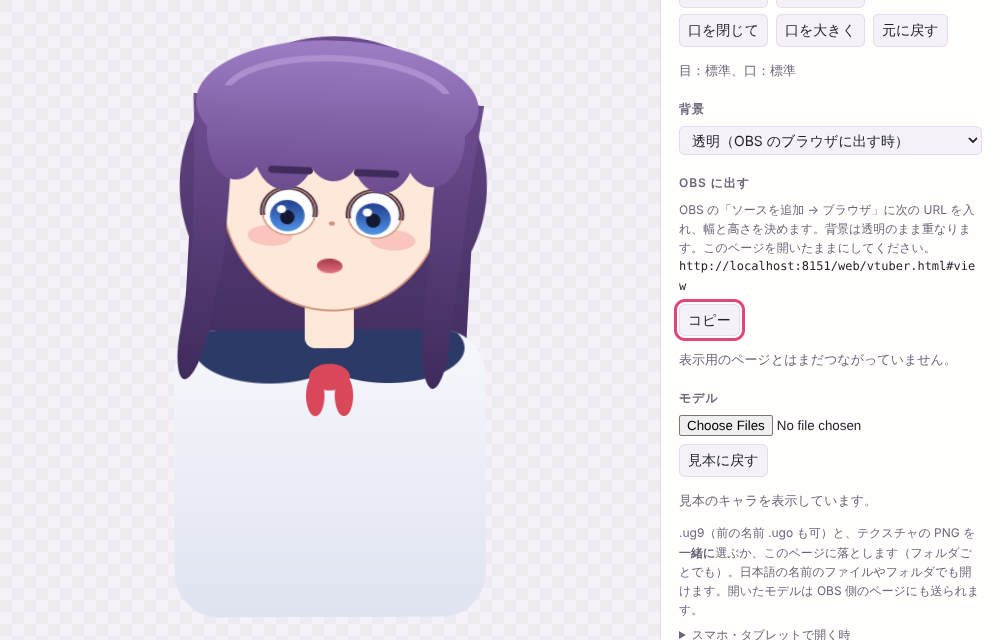
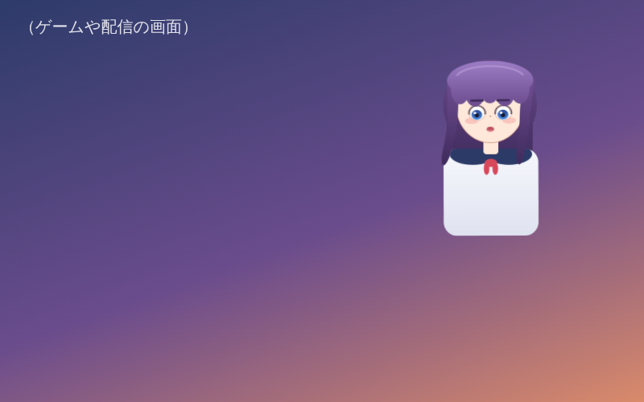

# VTuber として使う（Ugo9 VTuber）

カメラで顔の動きを読み、Ugo9 のキャラを動かして、配信ソフト OBS に重ねるためのページ。ブラウザだけで動き、インストールは要らない。

## 動かせる所・動かせない所

カメラは**顔だけ**を読む。腕や手の動きは読まない。

| 動く | 動かない |
|---|---|
| 顔の向き（左右・上下）と傾き | 腕・手・指 |
| 体の向き（顔の左右に少しついてくる） | 足・全身（歩く・跳ぶ・しゃがむ） |
| 目の開け閉め（まばたき・ウインク）と視線 | 肩の上げ下げ、体の前後 |
| 眉の上げ下げ | 口の形（「あ・い・う・え・お」の違い）。開け閉めの大きさだけ |
| 口の開け閉め（カメラか、マイクの声の大きさで） | 笑い・怒りなどの表情（そう読まない。表情はモデルの側で作る） |
| 息・髪の揺れ（自動。顔を読まなくても動く） | 舌、頬のふくらみ |

- キャラにそのパラメータが無ければ、その所は動かない（例：視線のパラメータが無いモデルは目が動かない）。名前は [パラメータの名前](パラメータの名前.md) の標準の名前（`HeadTurnX` など）か、今の道具の名前（`AngleX` など）
- 顔を大きく横に向けた時（約 38° より先）と、顔を見失った時は、目は自動のまばたきに変わる
- 画面の上の方にも、同じことを短く書いてある

## はじめて使う（4 つの手順）

画面の「はじめての方へ」にも同じ手順がある（はじめて開いた時は開いている）。

**1. 開く**：`node tools/serve.mjs` の後、ブラウザで `http://localhost:8099/web/vtuber.html`。見本のキャラが出る。自分のモデルは右の「モデル」で .ug9 と PNG を選ぶか、ページに落とす（下の「モデルを開く」）。

**2. カメラを許す**：「カメラを開始」を押し、ブラウザが聞いてきたら「許可」を選ぶ。初回は顔を読む部品を読み込むので数秒かかる。「読み取り中」と出れば、キャラが顔に合わせて動く。

許可されない・カメラが見つからない時は、理由が画面に出て、キャラを指でなぞる・マウスを動かすと顔がそちらを向く形に変わる。

**3. 正面を合わせる**：カメラの方をまっすぐ見て「今の向きを正面にする」。カメラが横や上にある時も、これで正面がそろう。目や口が小さく映る時は「その人に合わせる」の 4 つのボタン（目を開けて・目を閉じて・口を閉じて・口を大きく）も押す。

**4. OBS に重ねる**：「OBS に出す」の URL を「コピー」し、OBS の「ソースを追加 → ブラウザ」の URL に貼る。幅と高さを決める（例 800×1000）。背景は透明のまま、ゲームや配信の画面に重なる。手順 1 のページは開いたままにする（このページが顔を読み、OBS 側へ送る）。

絵は `node tools/vtuber_guide_shots.mjs` で作り直せる（ページを変えた時に）。カメラの映像は絵に入れない。

## 使い方（全部の手順）

1. リポジトリのフォルダで `node tools/serve.mjs` を実行する（Node.js が要る）
2. ブラウザ（Chrome か Edge）で `http://localhost:8099/web/vtuber.html` を開く
3. 「カメラを開始」を押し、カメラの使用を許可する。初回は顔を読む部品（MediaPipe）を読み込むので数秒かかる
4. カメラに正面を向いて「今の向きを正面にする」を押す。目や口が小さく映る時は「その人に合わせる」の 4 つのボタンも（下の表）
5. （好みで）「マイクを開始」で、声の大きさでも口が動く。何も話さずに「今の音」を見て、その少し上に「雑音の門」を置く
6. OBS で「ソースを追加 → ブラウザ」を選び、ページに表示された URL（`http://localhost:8099/web/vtuber.html#view`）を入れる。幅と高さは好みで（例 800×1000）。背景は透明のまま重なる
7. 手順 2 のページは開いたままにする（このページが顔を読み、OBS 側のページへ動きを送る）

OBS のブラウザ表示ではカメラを直接使えないことが多いので、「顔を読むページ（普通のブラウザ）」と「表示するページ（OBS）」を分け、`tools/serve.mjs` が手元の PC の中だけで動きを中継している。中継は `127.0.0.1`（この PC の中）からしかつながらない。

背景を緑や青にして、OBS の「ウィンドウキャプチャ」とクロマキーで重ねることもできる（中継を使わない方法）。

## モデルを開く

右の「モデル」で、`.ug9`（前の名前 `.ugo` も可）と、テクスチャの PNG を**一緒に**選ぶ。ファイルをページに落としてもよい（フォルダごと落とすと、中のファイルを全部見る）。開いたモデルは OBS 側のページ（`#view`）にも送られる（`tools/serve.mjs` がこの PC の中のメモリに置く。64 MB まで）。「見本に戻す」で見本のキャラに。

- **日本語の名前**：ファイルの名前もフォルダの名前も、日本語のままでよい。Mac は「ガ」を「カ」と「゛」に分けた形で名前を渡すことがあるが、比べる時にそろえるので、モデルの中のテクスチャの名前と同じ物として見つかる。大文字・小文字（`.PNG`）も問わない
- テクスチャはモデルの中の名前（最後の部分）で探す。見つからない時、PNG が 1 枚だけか枚数が同じなら、それを順に使い、そう知らせる。足りない時は、足りない名前を出す
- 読めないファイル（壊れた物、`.ug9` 以外）は、何がいけないかを出し、表示中のモデルはそのまま

### スマホ・タブレットで開く時

（ページをスマホで開く時。画面の「スマホ・タブレットで開く時」にも同じ説明がある）

- **Android**：`.ug9` と PNG を端末の「ダウンロード」（Download）フォルダに置き、「ファイルを選択」から「ファイル」アプリで選ぶ。2 つ目からは長押しで複数選べる。LINE・Google ドライブなどで受け取った物は、先に端末に保存する（クラウドのままだと選べないことがある）
- **iPhone・iPad**：「ファイル」アプリの「この iPhone 内」か iCloud Drive に置き、「ファイルを選択」→「ブラウズ」で選ぶ。右上の「選択」で複数選べる
- `.ug9` が灰色で選べない時：名前の最後が `.ug9` になっているか（`.ug9.zip`・`.ug9.bin` になっていないか）。このページは種類で絞らずに選ばせる（Android は知らない種類のファイルを灰色にすることがあるため）
- 今のところ、このページは PC の `node tools/serve.mjs` から開く。スマホのカメラで使うには、ページを https で置く必要がある（ブラウザがカメラを https か localhost でしか使わせないため）。置き場所はまだ決まっていない
- 試しに https で置くためのフォルダは `node tools/make_vtuber_artifact.mjs` で作れる（下の「1 つのフォルダに書き出す」）

### 1 つのフォルダに書き出す（https で試す時）

`node tools/make_vtuber_artifact.mjs [--out build/vtuber_artifact] [--no-face-model]` で、どこに置いても動くフォルダを作る（例：本人だけが見られる claude.ai の Artifact に置いて、スマホから試す）。

- 中身：`index.html`（このページを「単独」の形にした物）・`ugo.js`・`ugo.wasm`・`ugo_simd.wasm`（芯の SIMD 版。使えるブラウザではこちら）・`tracking.js`・見本のキャラ（`sample_model.ug9.wasm`・`sample_atlas.png`、CC0）・MediaPipe の顔のモデル（`face_landmarker.task.wasm`、Apache-2.0）・`THIRD_PARTY.txt`・`LICENSE-Apache-2.0.txt`。どれも相対の道で、約 4 MB（顔のモデルが 3.6 MB）。データのファイルは名前の最後を `.wasm` に（claude.ai の Artifact など、置ける種類が .html・.js・.wasm・.png などに限られる所でも置けるように。fetch で読むので中身の種類は関係ない）
- 単独の形：OBS 側のページへの中継と `tools/serve.mjs` を使わない（OBS の節は出ない）。モデルを開く・カメラ・マイクはそのまま
- 外から読むのは、MediaPipe の部品（cdn.jsdelivr.net、版 0.10.14 に固定）だけ。顔のモデルは書き出す時に一度取って `build/cache/` に置き、中身のハッシュを確かめてから入れる。`--no-face-model` なら入れず、Google の置き場所から読む
- カメラやマイクが使えない時（許可されない、ページを入れた画面が止めている、見つからない、https でない）は、何が使えないかを画面に出し、指でなぞる・マウスを動かすと顔がそちらを向く形に変わる

## 調整

| 項目 | 意味 |
|---|---|
| カメラ・大きさ | 使うカメラ（外付けなど）と映像の大きさ。大きいほど細かいが重い |
| 映像を左右反転・上下反転 | カメラが鏡像を出す時、逆さに付けた時に、読む前に元に戻す |
| 鏡のように動かす | 自分が左を向くと、キャラも画面の左を向く（鏡と同じ）。顔の向き・傾き・目の向き・体・左右の目が全部そろって変わる。外すとカメラの映像と同じ向き |
| マイク・雑音の門 | 声の大きさで口を開ける。門より小さい音（ファン）や、短い音（キーを打つ音、0.05 秒より短い）では開かない。言葉の間の短い途切れでは閉じない |
| 口を動かす物 | カメラとマイクの大きい方（既定）、カメラだけ、マイクだけ。口は速く開き、ゆっくり閉じる（エンジンの口の助けと同じ速さ） |
| 顔の向きの大きさ | 頭の動きに対して、キャラがどれだけ大きく向くか |
| 目の閉じやすさ | 小さいほど、少し目を細めただけで閉じる（「その人に合わせる」の後は、合わせた範囲が使われる） |
| 口の開きやすさ | 大きいほど、少し口を開けただけで大きく開く |
| なめらかさ：顔・目・口 | それぞれ、大きいほど止まっている時の揺れが減る。速く動いた時はすぐ追いつく（one-euro フィルタ。なめらかさ 1 でも、速く向いた時は 0.1 秒ほどで 9 割） |
| 両目 | そろえる（はっきりしたウインクだけ片目）、いつもそろえる、別々に動かす |
| パラメータの結び付け | 顔の値（顔の左右・目の開き・口など 11 個）が、モデルのどのパラメータを動かすか。名前から自動で決める（標準の名前・`AngleX` などの前の名前・`Param` の付いた名前）。自分のモデルの名前が違う時は、表で選び、大きさ（倍）と向き（逆）も変えられる。モデルごとにこのブラウザに覚える。顔・目・口が見つからない時は、表が開いて、動かない物を知らせる。口とまばたきも、選んだパラメータを動かす。「自動に戻す」で名前から決め直す |
| その人に合わせる | 「目を開けて」「目を閉じて」「口を閉じて」「口を大きく」を、その顔をしたまま押す。1 秒の間の値を覚え、その人の開き具合の範囲にする。差が小さすぎる時は覚えない。「元に戻す」で標準に |

顔を大きく横に向けて（38° より先）奥の目が見えない時や、顔を見失った時は、目は自動のまばたきになる（2〜6 秒ごと、エンジンのまばたきと同じ決まり）。マウスで動かす時は、顔・目・体がマウスの方を向く（`UgoLook`）。表示用のページには、口・目・向きの最後の値を送るので、両方のページで同じ動きになる。

設定はこのブラウザの中だけに保存される。

## ネットが無くても動かす

顔を読む部品（MediaPipe、約 22 MB）は、ふだんは初回にインターネット（cdn.jsdelivr.net と Google の置き場所、版は固定）から読む。`node tools/fetch_mediapipe.mjs` を一度動かすと、`web/vendor/mediapipe/` に置き（中身のハッシュを確かめる。git には入らない）、ページはそれを使うので、その後はネットが無くても動く。状態の文に「この PC の MediaPipe」と出る。

1 つのフォルダに書き出す時は `--offline` で、MediaPipe もフォルダに入る（約 23 MB。外から何も読まない）。

## 顔の動きとキャラの動き

顔の読み取りは別のスレッド（Web Worker、`web/tracking_worker.js`）で行うので、1 コマの読み取りが重い PC でも、キャラの描画は止まらない（読み終わった顔から順に使う）。ワーカーが使えない所では、ページの中で読む（`?worker=0` を付けると、比べるためにページの中で読む）。

MediaPipe Face Landmarker（Apache-2.0）が返す「頭の向き」と、ARKit と同じ名前の 52 個の表情の値を、キャラのパラメーターに変える（`web/tracking.js`）。

| キャラのパラメータ（標準の名前／今の見本の名前） | 元にする値 |
|---|---|
| `HeadTurnX`・`HeadTurnY`・`HeadTilt`（`AngleX`・`AngleY`・`AngleZ`） | 頭の左右・上下・傾き |
| `BodyTurnX`（`BodyAngleX`） | 頭の左右の 3 割 |
| `EyeOpenL`・`EyeOpenR` | eyeBlinkLeft・eyeBlinkRight（鏡の設定で左右を合わせる） |
| `PupilX`・`PupilY`（`EyeBallX`・`EyeBallY`） | eyeLookIn／Out／Up／Down |
| `MouthOpen` | jawOpen と mouthClose |
| `BrowHeightL`・`BrowHeightR`（`BrowY`） | browInnerUp・browOuterUp・browDown |

標準の名前（[パラメータの名前](パラメータの名前.md)）で書き、モデルに無ければ、かっこの中の名前や、`ParamAngleX` のように `Param` が付いた名前に書く。息と髪の揺れは、キャラの待機アニメと物理がそのまま動く。顔が見えなくなると、待機アニメへなめらかに戻る。

## 確かめたこと（`tests/vtuber_test.mjs`）

- 写真を左右反転すると頭の左右の向きが反転し、写真を時計回りに傾けると傾きの値が負になる。鏡の設定で、キャラの向きと傾きが画面上で合う
- 偽のカメラ（傾きが変わる動画）で、キャラの傾きが映像に合わせて動く
- 表示用のページが中継で動きを受け取り、背景が透明のままキャラを描く
- カメラが無い時、目が自動でまばたきする。カメラの一覧が出る。映像を左右反転すると、読んだ顔の傾きが逆になる
- 偽のマイク（Chromium のピッという音）で、門より小さい時は口が閉じたまま、門を下げると開く。表示用のページの口も動く
- モデルを開く（`tests/vtuber_open_test.mjs`）：日本語の名前のモデルとテクスチャを選んで開ける。落としても開け、PNG の名前が分けた形（NFD）・大文字でも名前で見つかる。OBS 側のページにも同じモデルが出て、「見本に戻す」で両方とも見本に。.ug9 が無い・壊れている・PNG が足りない・名前の違う PNG を使った、をそれぞれ知らせる
- 1 つのフォルダに書き出す（`tests/vtuber_artifact_test.mjs`）：フォルダだけを置いた別のサーバーで、見本が出る。外へは MediaPipe（cdn.jsdelivr.net、版を固定）だけ、顔のモデルはフォルダから、中継や `/vtuber/model` には行かない。カメラを断ると理由を出し、マウスで顔が左右を向く。マイクを断っても理由を出す。偽のカメラで顔を読める
- パラメータの結び付け（`tests/vtuber_open_test.mjs`）：名前の違うモデルでは動かない物を知らせ、表で選ぶと（大きさ 2、逆）顔の左右がそのパラメータを動かし、モデルを開き直しても覚えている。見本は全部が名前で結び付く
- 顔の読み取りが別のスレッドで動く（`tests/vtuber_test.mjs`）：読み取り中の描画が、ワーカーで 17 コマ／秒、ページの中で読むと 3 コマ／秒（この入れ物のソフトの GPU で。読み取り 1 回 約 150 ms）
- ネットが無くても（`tests/mediapipe_local_test.mjs`）：取ってきた MediaPipe でハッシュが合い git に入らない、ネットを全部断っても偽のカメラで顔を読める（ワーカーで）、外には何も聞きに行かない。`--offline` のフォルダも同じく（`tests/vtuber_artifact_test.mjs`）
- 顔と声の決まりは `tests/tracking_test.mjs`（ブラウザ無し）：鏡の入・切で左右の値が全部そろって変わる、両目のそろえ方、その人に合わせる、顔・目・口で別々のなめらかさと速い動きへの追従、目を見失った時、雑音の門（キーの音では開かない）、口を動かす物の選び方

テストには MediaPipe が公開している見本の写真を使う（その場でダウンロードし、リポジトリには入れない）。

## まだのこと

- 実際のカメラ・実際の OBS での確認（この環境ではカメラも OBS も使えない）
