# チュートリアル

エディタでは「ヘルプ → チュートリアル」で開きます。

Ugo9 エディタで、キャラに動きを付ける手順を 5 つの例で説明します。どれも、手を動かしながら読むための文書です。アプリが手順を案内したり、自動で次へ進めたりはしません。

- 動きがどの段でできるか（パーツ → 変形 → パラメータ → キーの形 → アニメ）は、先に「ヘルプ → 動きの仕組み」（F1）を読むと分かりやすくなります。
- 絵の赤い枠は、その手順で見る所・押す所です。
- 絵はテスト（`node tests/editor_tutorial_test.mjs --shots`）で撮り直しています。画面が変わると、絵も撮り直されます。

| 例 | 使うキャラ | 覚えること |
|---|---|---|
| 0. 半身の立ち絵を少しだけ動かす（いちばん短く） | 自分の PSD（半身の立ち絵） | 下書きをまとめて作る、揺れ物、透過の動画 |
| 1. 顔の左右を付ける | テスト用の PSD（`tests/psd/face.psd`） | 4 点 → メッシュ、ワープデフォーマ、キーの形、パラメータの結合 |
| 2. まばたき | 1 の続き | 自動の下書き、キーの上で直す |
| 3. 髪を物理で揺らす | 見本のキャラ（アプリを開いた時のキャラ） | 骨、物理のチェーン、物理のオン・オフ |
| 4. 待機のアニメ | 3 の続き | アニメの作業の場、自動キー、再生 |

## 0. 半身の立ち絵を少しだけ動かす（いちばん短く）

配信の立ち絵や、ゲームの会話の絵のように、半身の絵を「まばたき・呼吸・少しの揺れ」だけで動かします。細かく直すのは後からでかまいません。目安は 10〜15 分です。

### 0-1. PSD を用意する

- 目は「開き」と「閉じ」、口は「閉じ」と「開き」を別のレイヤーにします。顔・体・前髪・後ろ髪も分けます
- レイヤー（またはフォルダ）の名前を、`目_開き`・`目_閉じ`・`口`・`顔`・`体`・`前髪`・`後ろ髪` のようにします。自動の道具は名前で見分けます（くわしくは「ヘルプ → PSD の描き方」）
- 髪を揺らしたい時は、髪をフォルダに分けておき、「ファイル → PSD を開く時：グループを骨に」に印を付けます

### 0-2. 開いて、下書きをまとめて作る

1. PSD を開く（画面に落とすか「ファイル → 開く…」）。大きな絵で重い時は「ファイル → 読む大きさ」を × 1/2 にして開きます
2. 「パラメータ → 自動で作る：下書きをまとめて」。顔のワープデフォーマ・顔の向き・目と口の開け閉じ・待機のアニメが一度にできます（取り消し 1 回で戻ります）
3. 右のパラメータのつまみを動かして、顔の向き・まばたき・口を確かめます。崩れる所があっても、ここでは気にせず先へ進みます

### 0-3. 髪を少し揺らす

- 「グループを骨に」で開いた時：「変形 → 物理のチェーンをまとめて作る」で、髪の骨が揺れるようになります
- 骨が無い時：髪のパーツを選び、「変形 → 揺らす…」。物理の窓が開いたら、型（髪など）で揺れ方を選べます
- 画面の上の「物理」の印で、揺れを止めたり動かしたりできます

### 0-4. 待機のアニメを見て、書き出す

1. 上の「アニメ」を押し（Alt+2）、Space で再生します。下書きで作った待機のアニメ（呼吸とまばたき）に、髪の揺れが重なります
2. 「ファイル → 書き出し：画像・動画（GIF・APNG・WebM・MP4）…」で、アニメを選んで書き出します
   - 配信ソフトに重ねる時は「WebM（透過）」か「透過の連番」に印を付け、「背景」の印を外します
   - 揺れはそのまま動画に入ります（ループするアニメは、1 周回してから書くので、つなぎ目で揺れが飛びません）
3. 「ファイル → 保存（.ugo9）」で、続きから直せる形で保存します

ここまでで動けば十分です。顔の向きを丁寧に直す時は 1 から、まばたきを直す時は 2 から読んでください。

## 1. 顔の左右を付ける

顔を左右・上下に振り向かせます。パラメータ HeadTurnX（左右）と HeadTurnY（上下）に、顔の形を付けます（前のエディタで作ったモデルや見本のキャラでは AngleX・AngleY という名前です。働きは同じです）。

### 1-1. PSD を開く

「ファイル → 開く…」で PSD を選びます。

レイヤーが 1 枚ずつパーツになり、左の「パーツ」に並びます。パーツは、Live2D と同じく絵の四角（4 点）で入ります。

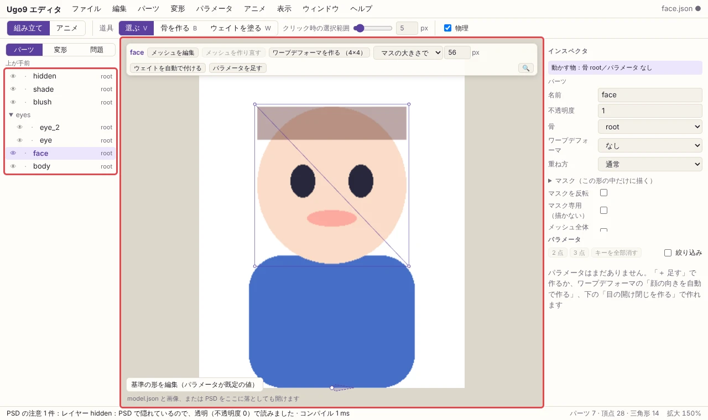

### 1-2. メッシュを作る

4 点のままでも動かせますが、曲げると粗くなります。曲げたいパーツにはメッシュ（三角形の網）を作ります。

- 1 枚だけ：パーツを選んで「パーツ → メッシュを作る（選んだパーツ：…）」
- まとめて：何も選ばずに「パーツ → メッシュを作る（4 点のパーツ全部）」

ここでは、まとめて作ります。

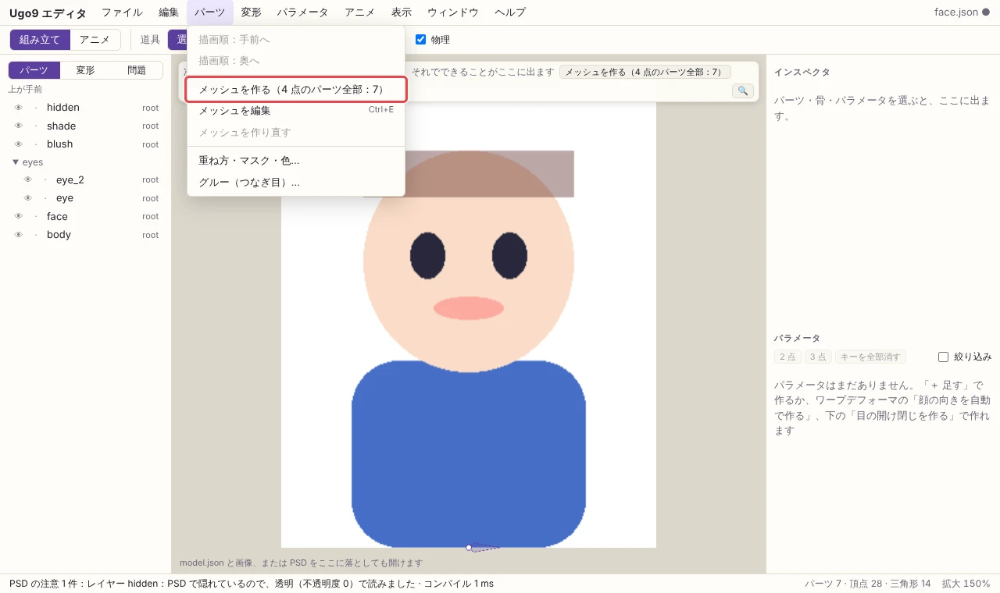

パーツを選ぶと、メッシュの線と頂点が見えます。

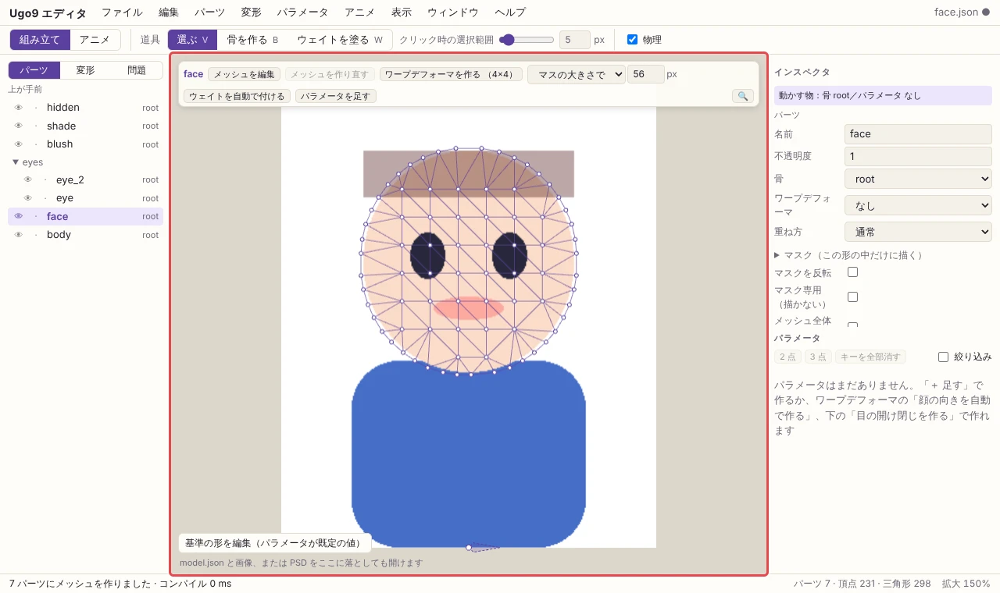

### 1-3. ワープデフォーマを作る

左の「パーツ」で face を選び、左の「変形」を押してから「変形 → ワープデフォーマを作る」。

顔を囲む緑の網（ワープデフォーマ）ができます。左の「変形」の下に、ワープデフォーマの一覧があります。選んでいないワープデフォーマも、外枠が点線で薄く見えます。

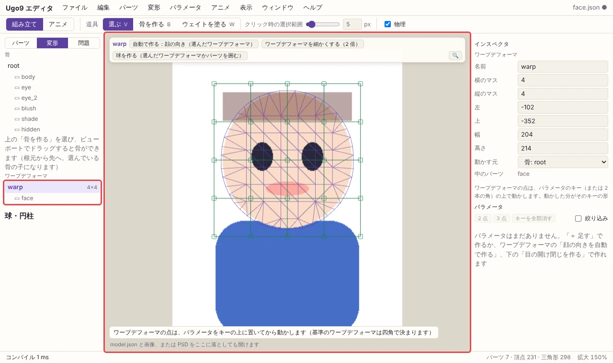

### 1-4. 顔の向きの下書きを作る

ワープデフォーマを選んだまま「パラメータ → 自動で作る：顔の向き（選んだワープデフォーマ）」。

- 「ワープデフォーマに入れますか？」と聞かれたら OK を押します。目なども顔と一緒に向きを変えるようになります。
- 右下に HeadTurnX と HeadTurnY ができます。両端と 4 つの角に、振り向きの形（キーの形）ができています。

### 1-5. 結合した格子で確かめる

HeadTurnX と HeadTurnY は、はじめから**結合**しています（左の鎖のボタンが濃い色）。2 本のつまみの代わりに、右下に格子が 1 つ出ます。横が HeadTurnX、縦が HeadTurnY です。

格子の中をドラッグすると、2 つの値が一度に動きます。右上の角へ動かすと、右上を向きます。

- 丸は、キーとキーの組み合わせです。近くまで動かすと吸い付きます（Alt を押している間は吸い付きません）。丸を押すと、その組み合わせへ飛びます。
- Shift を押しながらドラッグすると、横か縦の一方だけが動きます。
- 右の 2 つの欄は HeadTurnX と HeadTurnY の値です。欄に打つと、その 1 本だけが変わります。
- 鎖のボタンを押すと結合が外れ、2 本のつまみに戻ります。もう一度押すと（下のつまみと）結合します。

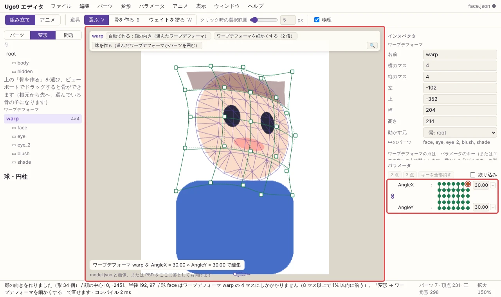

### 1-6. 形を直す

自動の形は下書きです。直す時は、つまみを**キーの上**に置いてから、ワープデフォーマの点を動かします。

1. 「パラメータ → 値をすべて戻す」
2. 格子の右の辺の真ん中の丸（HeadTurnX 30・HeadTurnY 0）を押す
3. 左の「変形」でワープデフォーマを選び、画面の四角い点（取っ手）をドラッグ

画面の左下に「ワープデフォーマ warp を HeadTurnX = 30.00 で編集」と出ていれば、そのキーの形になります。キーとキーの間では、形がなめらかにつながります。

- キーの上でない時は、取っ手は薄い枠になり、押すと「キーの上に置いてから」と出ます。
- 格子の角の丸（2 本とも既定でないキーの上）を押すと、角の形（右を向きながら上を向いた時だけの形）を直せます。

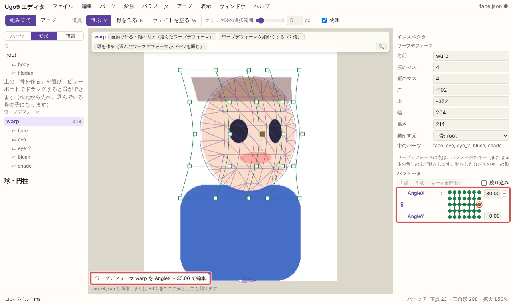

## 2. まばたき

1 の続きです。目を閉じる形を、パラメータ EyeOpenL・EyeOpenR（1 で開き、0 で閉じる）に付けます。

### 2-1. まばたきの下書きを作る

「パラメータ → 自動で作る：まばたき」。パーツの名前（目・まぶた・eye など）から目を探して、閉じた形の下書きを作ります。

EyeOpenL と EyeOpenR を 0 にすると、目が閉じます。

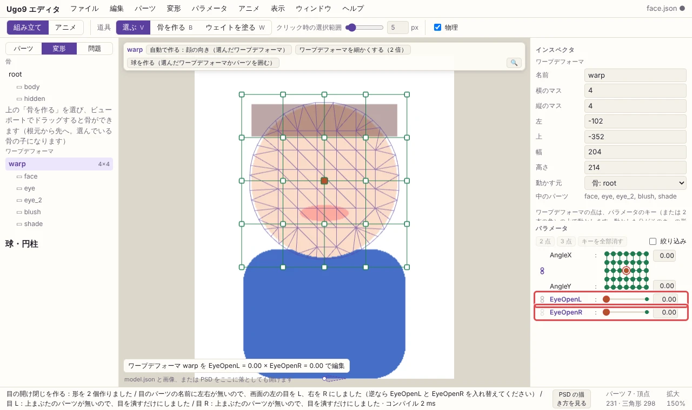

### 2-2. 形を直す

1. 「パラメータ → 値をすべて戻す」
2. EyeOpenL のスライダーの左端の点（キー 0）を押す
3. 左の「パーツ」で目のパーツを選び、画面の頂点をドラッグ（四角で囲むと何点かまとめて選べます）

左下に「… EyeOpenL = 0 …」と出ていれば、そのキーの形になります。

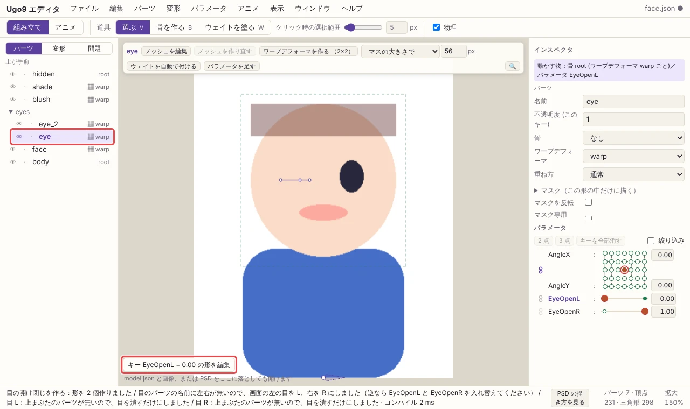

## 3. 髪を物理で揺らす

アプリを開いた時の見本のキャラを使います（別のファイルを開いた後は、アプリを開き直すと戻ります）。髪の骨に物理のチェーンを付けて、頭の動きに遅れて揺れるようにします。

### 3-1. 髪の骨を選ぶ

左の「変形」で骨 hairL1 を選びます。

- 画面では、骨の線（針）をつかんでドラッグすると、根元を中心に骨が回ります（角度が数字で出ます）。根元の丸をつかむと動きます。
- その骨でどこが動くかが、色の点（ウェイト。青＝少し、赤＝全部）と薄い線で見えます。

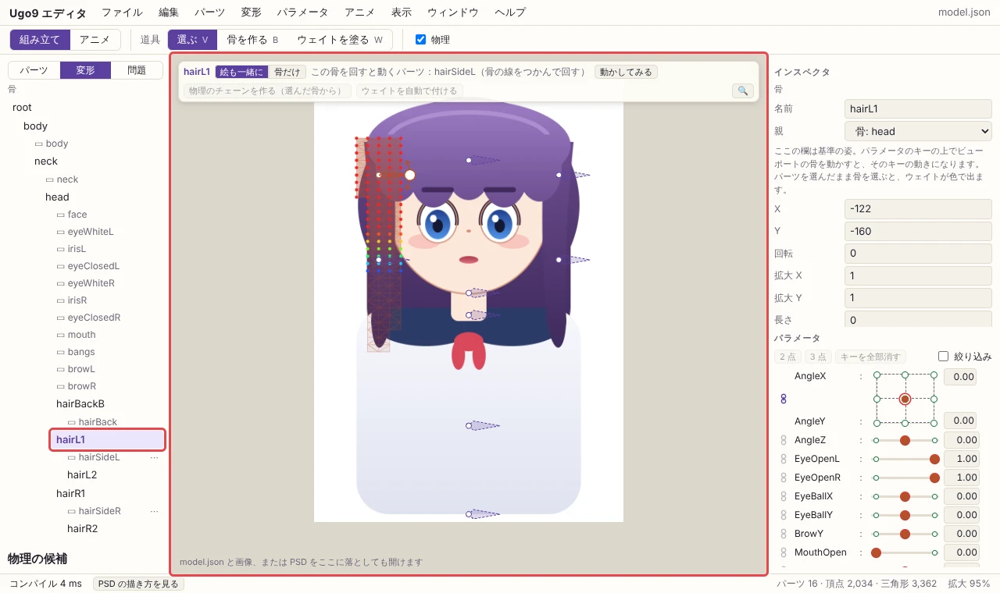

### 3-2. 物理のチェーンを作る

「変形 → 物理のチェーンを作る（選んだ骨から）」。hairL1 から先（hairL2）までが 1 本のチェーンになります。

右のインスペクタで、重力・戻る強さ・減衰などを直せます。

- 左の「物理の候補」には、名前（髪・リボン・スカートなど）から揺れそうな骨の並びが出ます。「チェーンにする」でも作れます。

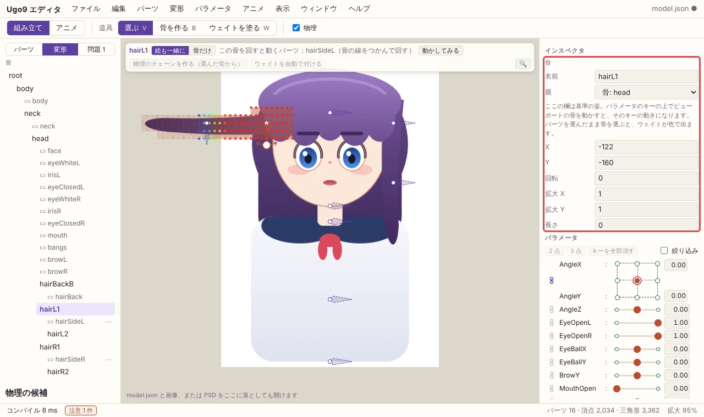

### 3-3. 揺らして確かめる

上の帯の「物理」に印が入っている時、物理が動きます（物理のオン・オフ）。AngleX を左右に動かすと、髪が遅れて揺れます。

- 形を直す時は「物理」の印を外すと、髪が止まった姿で編集できます。

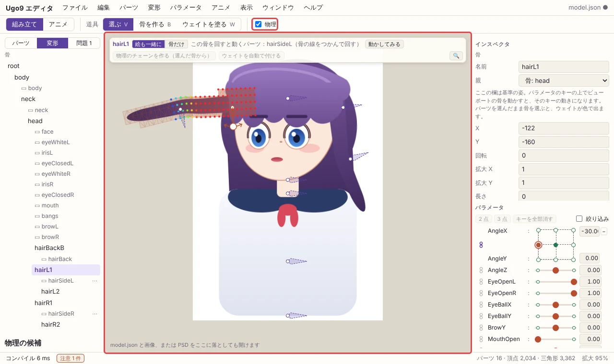

## 4. 待機のアニメ

3 の続きです。待っている時の小さな動き（体のゆらぎ・まばたき）を作り、自分でもキーを足します。

### 4-1. アニメの作業の場で、待機のアニメを作る

上の「アニメ」を押す（「ウィンドウ → アニメ」、Ctrl+Tab または Alt+2）と、下に時間軸が出ます。

「アニメ → 待機のアニメを作る」。ループするアニメができて、時間軸に行（トラック）とキー（ひし形）が並びます。見本のキャラのように待機のアニメ（idle）がもうある時は、置き換えるか・足すかを聞かれるので、「「idle2」として足す」を押します。

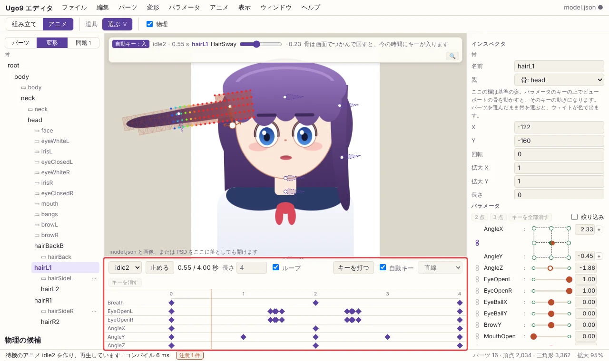

### 4-2. キーを足す

1. Space で再生・停止します。止めておきます。
2. 時間軸の目盛りを押して、時間を 1 秒にする
3. つまみ（ここでは MouthOpen）を動かす

アニメの作業の場では、つまみを動かすとその時間にキーが打たれます（「アニメ → 自動でキーを打つ」。最初から入っています）。外すと、つまみは見るだけになり、キーは I で打ちます。K・J で次・前のキーへ時間が飛びます。

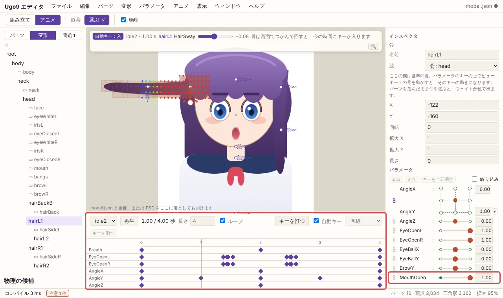

### 4-3. 再生して、書き出す

- Space で再生します。
- 「ファイル → 書き出し：画像・動画（GIF・APNG・WebM・MP4）…」で動画に、「ファイル → 書き出し：Ugo9 データ（.ug9）」でゲームやアプリで動かすデータになります。
- 「ファイル → 保存（.ugo9）」で、続きから直せる作業ファイル（作業用の JSON と絵を 1 つにまとめた物）を保存します。

## 5. 仕上げと動きの便利な道具（見本のまま、短く）

### 5-1. ランダムポーズで崩れを探す

「表示 → ランダムポーズ」に印を入れると、パラメータが次々に動きます。崩れた形が出たら **Esc** で、その形のまま止まります。「表示 → ランダムポーズの前に戻す」で元の値に戻ります。文書は変わりません。

### 5-2. オニオンスキンで前後を見る

アニメの作業の場で、時間軸の「オニオン」に印を入れます。止めている時、今の前の姿が赤み、後の姿が青みで薄く重なります。⚙ で間隔・枚数・濃さを変えられます。

### 5-3. つまみを動かして記録する

時間軸の「● 記録」を押すと、3・2・1 の後に再生が始まります。その間に右の欄の **AngleX** のつまみを左右に動かし、**Esc** で止めると、動かした通りのキーができます（1 歩で取り消せます）。

### 5-4. 物理を焼き付ける

「アニメ → 物理をアニメに焼き付ける…」→「今のアニメ」で、髪の揺れがキーになります。続けて聞かれたら「残す」を選びます（このチュートリアルでは物理をそのまま使うため）。

## 6. まとめて作る・すき間を埋める・くり返す（短く）

### 6-1. アニメをフォルダに分ける

アニメの作業の場で、時間軸の左の「アニメの一覧」の「**＋ フォルダ**」を押し、名前を打って（そのままでも）OK を押すと、選んでいるアニメが入ったフォルダができます。ほかのアニメは、名前をフォルダの見出しへ引いて入れます。アニメが増えても探しやすくなります。

### 6-2. ワープデフォーマをまとめて作る

組み立ての作業の場で「変形 → ワープデフォーマをまとめて作る…」を開き、「**作る**」を押します。印の付いたパーツ（まだワープデフォーマに入っていないパーツ）に 1 つずつ、ぴったり囲むワープデフォーマができます。1 歩で取り消せます。

### 6-3. パーツを複製する

パーツを選んで **Ctrl+D**（パーツ → パーツを複製）。すぐ手前に、キーの形やグルーごと写したパーツができます。

### 6-4. すき間に描き足す

パーツを選んで「パーツ → 絵を描き足す」。上の帯の「ランダムポーズ」で動かしながら、すき間が見えた所をなでて描きます。**Esc** で終わります。描き足しは「ファイル → 描き足しを PSD に書き戻す…」で PSD に戻せます。

### 6-5. 手順をマクロにする

「編集 → マクロを記録」を押してから、パーツを選んで **Ctrl+D**。もう一度「編集 → マクロを記録」を押すと、今の手順がスクリプトの窓に開きます。「**走らせる**」で、同じ手順をもう一度します。名前を付けて「この PC に残す」と、ほかのモデルでも使えます。

## この先

- どのメニューに何があるか：「ヘルプ → 使い方」。名前が分からない時は F3 で、やりたいことを打つ（「マスクをまとめて」「文字を大きく」「左右対称のメッシュ」など）
- キー操作：「ヘルプ → キー操作」
- 絵の描き方（レイヤーの分け方・名前）：「ヘルプ → PSD の描き方」
