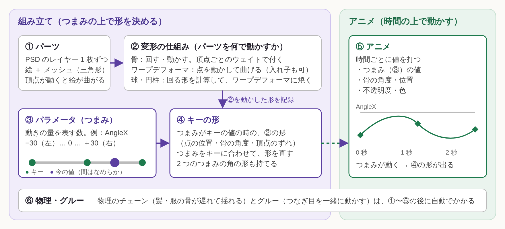

# Ugo9 で動きができる仕組み

エディタでは「ヘルプ → 動きの仕組み」（F1）で開きます。

After Effects・Live2D・Spine・Procreate から来た人は、それぞれの言葉と Ugo9 の道具の対応表「ヘルプ → ほかのアプリから来た人へ」（[移る人の手引き](移る人の手引き.md)）も見てください。

## 5 つの段

Ugo9 のキャラは、次の順に重ねて動きます。エディタの作業も、だいたいこの順です。

1. **パーツ**：PSD のレイヤーが 1 枚ずつパーツになります。パーツは絵とメッシュ（三角形の網）でできていて、メッシュの頂点が動くと、絵がその分だけ曲がります。
2. **変形の仕組み**：パーツを何で動かすかを決めます。
   - **骨**：回したり動かしたりします。パーツの頂点は、ウェイトで骨に付きます。腕・体・髪の束のように、回って動く所に向きます。
   - **ワープデフォーマ**：パーツの上にかぶせた網です。網の点を動かすと、中のパーツが曲がります。ワープデフォーマの中にワープデフォーマを入れられます。顔の向きや表情のように、絵を柔らかく曲げる所に向きます。
   - **球・円柱**：顔や体を丸い物として回した形を計算し、ワープデフォーマの形として焼き込みます。焼いた後は、ふつうのワープデフォーマの形として直せます。
3. **パラメータ**：動きの量を表すつまみです。たとえば `AngleX` は顔の左右の向きで、−30 が左、0 が正面、30 が右です。つまみには**キー**（決まった値の点）を置きます。
4. **キーの形**：つまみがキーの値にある時の、②の形です。ワープデフォーマの点の位置・骨の角度・頂点のずれを持ちます。
   - つまみをキーに合わせてから②を動かすと、その形がそのキーに記録されます。
   - キーとキーの間では、形がなめらかにつながります。
   - 2 つのつまみ（左右と上下など）を同時に動かした時の、角の形も持てます。
5. **アニメ**：時間ごとに、つまみの値や骨の角度を打ちます。つまみが動くと、④で作った形が出ます。待機・まばたき・話す、などのアニメを作ります。

これらの後に、**物理**（髪・服の骨が遅れて揺れる）と**グルー**（2 つのパーツのつなぎ目を一緒に動かす）が自動でかかります。

## 2 つの作業の場

| 作業の場 | 何を決めるか | 主に触る物 |
|---|---|---|
| 組み立て | つまみの値ごとの形（①〜④） | パーツ・骨・ワープデフォーマ・球、パラメータのつまみ、キー |
| アニメ | 時間ごとの動き（⑤） | 時間軸、つまみ・骨のキー |

組み立ての中に「時間」はありません。アニメの中では形を作りません（形は組み立てで作り、アニメでは「どの形をいつ出すか」を決めます）。

## Live2D・Spine・Blender の言葉との対応

| Ugo9 | Live2D Cubism | Spine | Blender |
|---|---|---|---|
| パーツ（絵＋メッシュ） | アートメッシュ | アタッチメント（メッシュ）・スロット | Object（Mesh） |
| 骨 | 回転デフォーマ（近い） | ボーン | Bone（Pose Mode） |
| ウェイト | （無し。デフォーマに入れる） | ウェイト | Weight Paint |
| ワープデフォーマ | ワープデフォーマ | （無し） | — |
| 球・円柱 | （無し。顔の向きの自動生成が近い） | （無し） | — |
| パラメータ（つまみ） | パラメータ | （無し。アニメで直接動かす） | — |
| キー（つまみの上の点） | キー | （無し） | — |
| キーの形 | キーフォーム | （無し。近いのは時間の上の変形キー） | — |
| 2 つのつまみの角の形 | 四隅のキーフォーム | （無し） | — |
| キーの形の足し方 | ブレンドシェイプに近い（差を足す） | — | — |
| 組み立て | モデリング | セットアップ | Layout・Modeling のワークスペース |
| アニメ | アニメーション（モーション） | アニメーション | Animation のワークスペース |
| アニメのキー | タイムラインのキー | タイムラインのキー | Keyframe |
| 物理のチェーン | 物理演算 | 物理制約 | — |
| グルー | グルー | （無し） | — |
| 制約（IK など） | （無し） | IK・トランスフォーム制約 | — |
| 線に沿って流す | 変形パス（近い） | パス制約（近い） | — |
| 選択セット | （無し。Solo が近い） | — | Local View（近い） |
| 口パク（音声から） | リップシンク・モーションシンク | — | — |
| 物理をアニメに焼き付ける | 物理演算のアニメーションベイク | — | — |
| オニオンスキン | オニオンスキン | ゴースト | Onion Skin（グリースペンシル） |
| 下絵 | 下絵の配置 | — | Reference Image |
| アニメのフォルダ | モーションのグループ（近い） | — | — |
| 形の足し方：足し算だけ／四隅も直せる | ブレンドシェイプ／通常のキーフォーム | — | Shape Keys（足し算） |
| まとめて編集（キーの点を Ctrl+クリック） | マルチキー編集 | — | — |
| パラメータをまとめて動かす | 複数パラメータの同時操作 | — | — |
| メッシュの編集のミラー | ミラー編集 | — | X Mirror（Mesh） |
| 形を初期に戻す | デフォーマの初期化 | — | — |
| パーツを複製 | アートメッシュの複製（グルーは外れる） | アタッチメントの複製 | Duplicate |
| 絵を描き足す | （無し。描くアプリで） | （無し） | Texture Paint |
| ワープデフォーマをまとめて作る | （1 つずつ） | — | — |
| マスクの一覧 | クリッピング（パーツごとの設定） | クリッピング | — |
| スクリプト・マクロ | （無し） | （無し） | Python スクリプト（近い） |

Blender の列は、公式の説明で確かめられた物だけを書いています（docs/調査_画面の作り.md）。「—」は、対応する物が無いか、確かめられなかった物です。

- **Spine を使っている人へ**：骨とウェイト、アニメの時間軸はほぼ同じです。違いは、③④の「つまみの上で形を決める」段があることです。Spine では、形の変化も時間の上のキー（変形キー）で作ります。Ugo9 では、形はつまみの値の上に作っておき、アニメではつまみを動かします。そのため、同じ「顔の左右」をいくつのアニメでも使い回せます。
- **Live2D を使っている人へ**：パラメータ・キーフォーム・ワープデフォーマの考え方は同じです。違いは 2 つです。キーの形は掛け算のワープデフォーマではなく差の足し算です（ブレンドシェイプに近い）。骨とウェイトがあり、体は Spine のように骨で動かせます。
- 制約のうち IK は「変形 → IK を付ける」で作れます（腕・脚の先の丸を引くと曲がる）。transform 制約の画面はまだありません。

## やりたいことから探す

名前が分からない時は **F3** で、やりたいことを打つと道具が出ます（例：「汗を流したい」「口を声に合わせたい」「腕を曲げたい」「重なって触れない」）。

| やりたいこと | どこ |
|---|---|
| 汗・涙を線に沿って流す | 変形 → 線に沿って流す |
| 腕・脚を先で引いて曲げる | 変形 → IK を付ける |
| 今のキーの形を基準の形にする | パラメータ → 今の形を基準に |
| 揺れ方を型から決める・揺れすぎを直す | 変形 → 物理（パラメータの揺れ）… →「型から始める」、揺れ方は言葉と曲線で出る |
| 口を声に合わせる | アニメ → 口パク（音声から）… |
| あいうえおの口の形で口パク | アニメ → 口パク（音声から）… →「あいうえお」（母音ごとのパラメータ） |
| 口の絵を差し替えるアニメ風の口パク | アニメ → 口パク（音声から）… →「コマ替え」（口の絵ごとの不透明度を段で） |
| 重なって奥のパーツに触れない | 表示 → 選択セットを作る（その部分だけ見る・選ぶ）、編集 → 投げ縄で選ぶ |
| 崩れる形を探す | 表示 → ランダムポーズ |
| つまみを動かした通りにアニメを作る | 時間軸の「● 記録」（アニメ → 操作を記録してアニメにする） |
| 前後の姿を見ながら動きを付ける | 時間軸の「オニオン」（表示 → オニオンスキン） |
| いくつものキーの形に同じ直しを入れる | つまみのキーの点を Ctrl+クリック（まとめて編集）して、その 1 つで動かす |
| キーをまとめてずらす・別のアニメへ写す | 時間軸で囲んで選び、ドラッグ・Ctrl+C・Ctrl+V |
| 元の絵を重ねて見ながら合わせる | 表示 → 下絵… |
| 物理の無い所でも揺らす（書き出し・動画） | アニメ → 物理をアニメに焼き付ける… |
| 同じポーズをもう一度（アニメの別の時間に） | パラメータ → 値をコピー（今のポーズ）→ 時間を動かして 値を貼り付け |
| 左右をそろえる・中心線に合わせる | 表示 → グリッド、表示 → 定規（ガイドを引く）、表示 → グリッドとガイドに吸い付く |
| パラメータを広く見る・パネルを動かす | パネルのタブをドラッグ（ウィンドウ → レイアウト…で保存・初期に戻す） |
| 1 つのファイルで人に渡す | ファイル → 保存（.ugo9） |
| アニメ（モーション）が多くて探しにくい | アニメの場の「アニメの一覧」で ＋ フォルダ（アニメ → アニメのフォルダを作る…） |
| 形を足し算だけにする（ブレンドシェイプ）・反対側に −1 倍のキー | パラメータ → 足し算だけにする（ブレンドシェイプ）、パラメータ → 反対側に −1 倍のキーを作る |
| 選んだパラメータのキー全部に同じ直し | パラメータ → 選んだパラメータのキーを全部まとめて編集 |
| いくつものパラメータを 1 本のつまみで | パラメータの名前を Ctrl+クリック（パラメータ → 選んだパラメータをまとめて動かす組に入れる） |
| 左右対称のメッシュを作る | メッシュの編集（Ctrl+E）の帯の「ミラー」 |
| メッシュを細かく・粗く | メッシュの編集の帯の「細かさを変える」、パーツ → メッシュを作り直す |
| ワープデフォーマの形をやり直す | パラメータ → 形を初期に戻す（このキー・全部のキー） |
| 文字・パネルが小さい | 表示 → UI の大きさ（ブラウザ版は Ctrl ＋ ＋／−） |
| 同じパーツをもう 1 枚（グルーごと） | パーツ → パーツを複製（Ctrl+D） |
| 動かした時に背景が抜ける所（穴）を探す | パーツ → 穴を探す（動かすと抜ける所）…（各パラメータの両端とランダムポーズで探して桃色で出す。「描き足す」で 1 手） |
| 動かした時のすき間を絵で埋める | パーツ → 絵を描き足す（ランダムポーズで動かしながら）、ファイル → 描き足しを PSD に書き戻す… |
| パーツ全部にワープデフォーマ | 変形 → ワープデフォーマをまとめて作る… |
| いくつものパーツのマスクをまとめて・フォルダをマスクに | パーツ → マスクの一覧… |
| 同じ手順をくり返す・自動にする | 編集 → マクロを記録、編集 → スクリプト… |
| Krita・GIMP（.ora）・PNG の組から作る | ファイル → 開く…（PSD と同じに読む） |

## 1 体を作る時の順

1. PSD を開く（①）
2. 動かしたい所に骨やワープデフォーマを置く（②）
3. パラメータを足し、キーを置く（③）
4. つまみをキーに合わせて、形を作る（④）。顔の向き・目・口は「自動で作る」で下書きを作れます
5. アニメの作業の場で、時間ごとにつまみを動かす（⑤）
6. 書き出す

それぞれの段の操作は [エディタの使い方](エディタの使い方.md) にあります。
